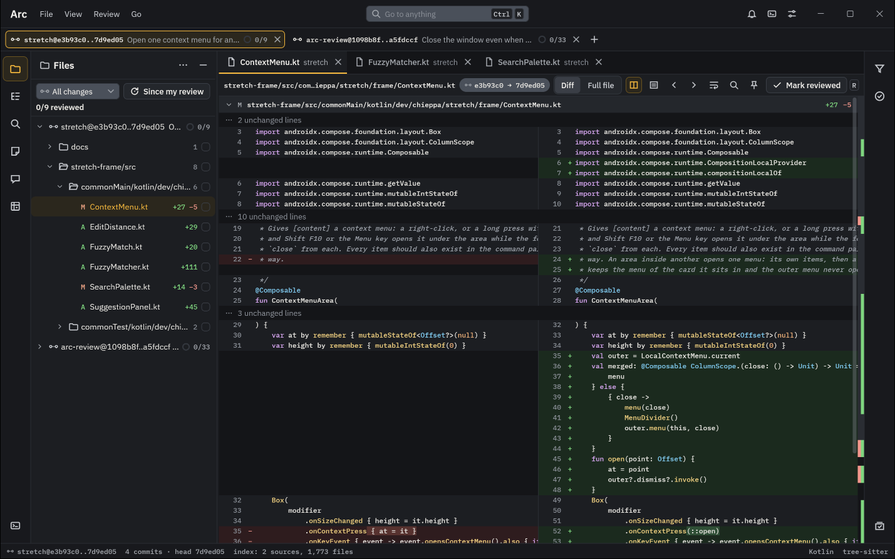
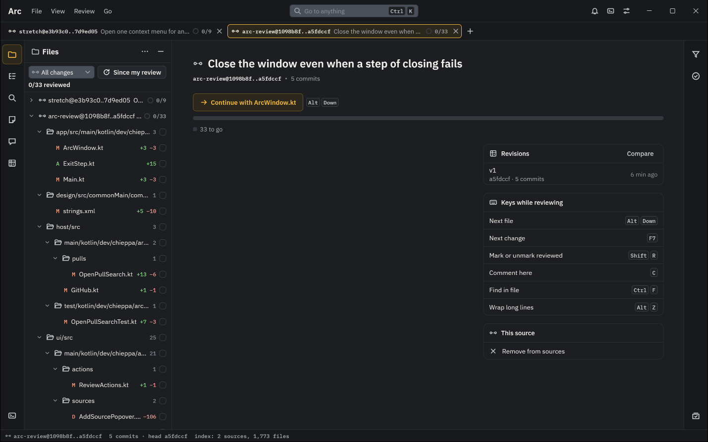
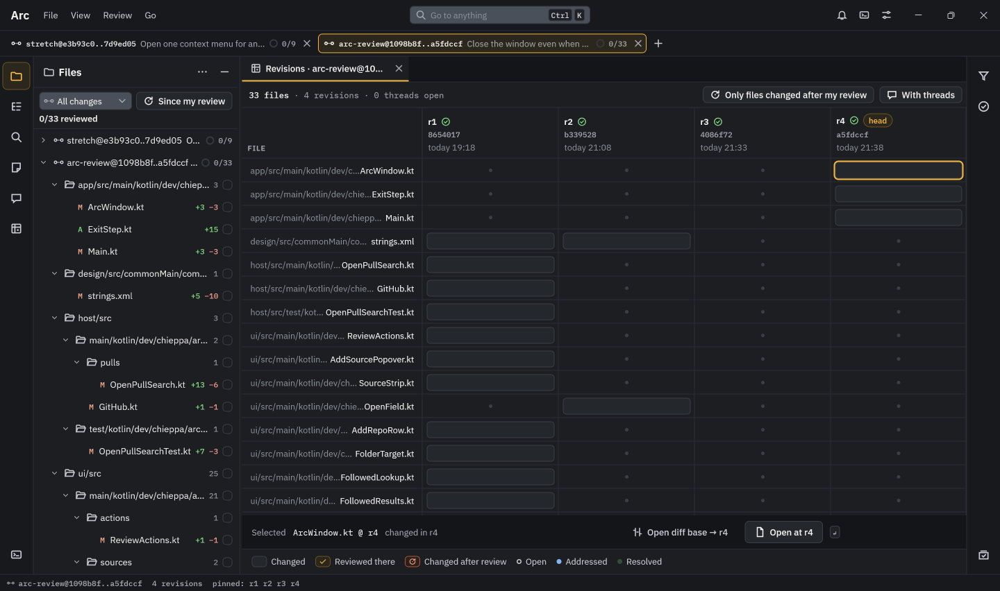

# Arc

Arc is a desktop code review app for Windows and macOS, built on [Stretch](https://github.com/nrc4867/stretch).
It is made for one person reviewing a lot of code: pull requests, commits, ranges and branches from several repos,
open side by side in one workspace that is saved between runs. Each source keeps its own panes, scroll and progress,
so switching between them is instant and loses nothing. Notes, marks and drafts stay on your machine until you push a
review on purpose.



## What sets it apart

| | |
| --- | --- |
| **Many sources, one workspace** | Pull requests, commits, commit ranges and branches from any number of repos sit in one strip, each with its own panes, open folders and reviewed count. |
| **Marks that survive a rebase** | A file marked reviewed stays reviewed when the change is rebased or amended without touching it, and is flagged when it really changed after your review. |
| **Every revision, side by side** | Arc records every head a source is read at, plus the force pushes GitHub knows of, and the revision matrix shows which file changed in which revision and where you reviewed it. |
| **Code navigation without a checkout** | A tree-sitter index of every open source answers Ctrl+click and usages at the exact revision under review, across repos, for Java, Kotlin, JavaScript, TypeScript and T-SQL. |
| **Search, not an inbox** | Saved GitHub searches poll in the background, rules raise desktop notifications, and Go to anything finds open pull requests, branches and recent sources fuzzily, or opens a pasted link. |
| **Nothing leaves by accident** | Comments are drafted, staged and sent as one confirmed review; notes never leave the machine and export to Markdown. |
| **Any file at any revision** | Open any file of any repo at any commit, pin it beside the diff, and keep it there while you move through the review. |

The start screen picks up where you left off: the next file to review, the source's revisions and the keys that matter.



The revision matrix sets a source's files against each revision it has had, to see what changed after you looked.



## Installing

Arc is released as one jar per platform, Windows x64 and Apple Silicon Macs, on the repo's GitHub releases page:
`arc-review-windows-x64-<version>.jar` or `arc-review-macos-arm64-<version>.jar`. Run it once with any Java 25 or
later:

```
java -jar arc-review-windows-x64-<version>.jar
```

Arc installs itself: it downloads the JetBrains Runtime it runs on (about 100 MB, once, checked against its pinned
SHA-256), copies the jar into its data folder, and adds Arc to the Start menu on Windows or to `~/Applications` on
macOS. Open Arc from there after that. Nothing needs an installer or signing, since Arc writes these files itself.

Arc checks its releases when it opens and once a day, with the same GitHub sign-in it uses for reviews. A newer
version shows as Update to <version> in the status bar and in Settings › General › Updates; Arc downloads it, checks it
against the release's `SHA256SUMS.txt`, and starts it on Restart to update. The previous version stays, and Settings
can switch back to it. Running a newer jar by hand updates the same way; an older jar opens the installed Arc instead.

From a terminal, `java -jar <jar> install` installs without the window (`--no-launch` leaves Arc closed after), and
`java -jar <jar> uninstall` removes the launcher, the runtime and the copied jars, keeping your data. Run uninstall
from a downloaded jar while Arc is closed, since a running Arc holds its own files open.

## Developing locally

You need:

- JDK 25 as `JAVA_HOME`. Gradle provisions the JetBrains Runtime the app runs on.
- A checkout of [Stretch](https://github.com/nrc4867/stretch) beside this one (`../stretch`), or its path as
  `stretch.dir` in `~/.gradle/gradle.properties`. Stretch is built from source as part of the build.
- git on the `PATH`, and for GitHub features the GitHub CLI signed in (`gh auth login`) or `GH_TOKEN` set.

```
./gradlew build                      # compile, test and check every module
./gradlew :ui:test                   # one module's tests
./gradlew :app:run                   # run the app
./gradlew :app:run -Pdemo            # run it with sample comment threads
./gradlew :app:run -Pdevtools=47811  # run it with window screenshots at 127.0.0.1:47811/capture
```

The first build also builds the tree-sitter libraries from source: it downloads a pinned zig and the grammars (about
100 MB, kept in `~/.gradle/arc-natives`) and takes a few minutes; later builds reuse them.

Stop a running app before rebuilding, or it will fail as classes change under it.

The app keeps its data in `%LOCALAPPDATA%\dev.chieppa.arc` on Windows and
`~/Library/Application Support/dev.chieppa.arc` on macOS: the workspace, the repos it knows, saved filters, drafts and
notes, and its own clones of GitHub repos. Delete that folder to start fresh.

How the code is laid out, and the rules it follows, are in [CLAUDE.md](CLAUDE.md).

## Licence

AGPL-3.0-only. See [LICENSE](LICENSE) and [NOTICE](NOTICE).
